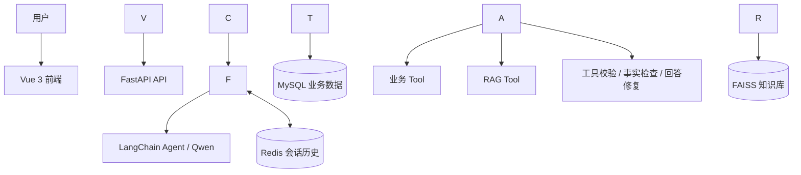

# 黄鳝智慧养殖 Agent 辅助决策系统

> 基于 Qwen + LangChain + Tool Calling + RAG/FAISS + FastAPI + MySQL + Redis + Vue 3 的前后端分离智慧养殖辅助决策演示系统。

本项目围绕黄鳝养殖的水质监测、投喂管理、增氧设备、生产告警与专业养殖知识问答，构建可通过自然语言交互的 AI Agent。Agent 能按问题调用业务 Tool、读取 MySQL 记录、检索 FAISS 知识库，并生成中文分析和处理建议。

**项目性质：** 当前使用养殖业务数据和项目演示告警阈值，适用于技术学习、功能演示与项目展示；不等同于真实传感器实时监控，AI 建议不能替代现场检测或专业决策。

## 系统运行效果

!\[黄鳝智慧养殖 Agent 系统运行界面](docs/images/system-overview.png)

界面包含水温、溶氧、pH、氨氮、投喂记录、增氧设备状态、异常预警、历史告警、水质趋势、AI 多轮聊天及知识库来源展示。

## 技术栈

|模块|技术|作用|
|-|-|-|
|大模型|Qwen API|自然语言理解、工具选择、分析报告生成|
|Agent|LangChain、Tool Calling|多工具编排与业务查询|
|知识检索|RAG、FAISS、Embedding|养殖知识库问答与检索来源展示|
|后端|Python、FastAPI、SQLAlchemy|REST API、业务数据访问|
|数据库|MySQL|水质、投喂、设备、告警等业务记录|
|会话存储|Redis|按 `session\_id` 保存多轮聊天记录|
|前端|Vue 3、Vite、Axios、Markdown|数据看板、风险提示和聊天界面|

## 核心功能与设计亮点

* **多业务 Tool 调用：** 涵盖生产批次、苗种质量、水质、投喂、设备、历史告警六类业务查询，以及养殖知识库 RAG Tool。
* **工具结果校验与补查：** 对必要业务 Tool 的返回结果进行有效性检查；必要数据缺失时尝试自动补查，避免基于不完整数据生成结论。
* **业务事实优先：** 最新业务指标必须来自本轮 Tool 查询；Redis 仅提供多轮上下文，不替代 MySQL 数据。
* **事实风险控制：** 对部分跨时间误判、未经证实的因果关系、持续状态推断及不恰当药剂建议进行规则筛查；必要时尝试一次回答修复，仍不通过则安全降级。
* **RAG 来源展示：** 检索黄鳝养殖专业知识，并在页面中呈现对应的知识库文件来源。
* **主动水质预警：** 根据项目演示配置判断异常；水质记录超过 24 小时则不作为实时预警依据；同类告警有 24 小时去重窗口。
* **前后端分离交互：** 看板、趋势图、Markdown 回答、多轮消息、加载耗时提示和新会话管理。

## 系统架构



## 项目目录

```text
yellow-eel-agent/
├── Fish/                         # FastAPI 后端
│   ├── agent/                    # Agent 主流程、模型封装与路由
│   ├── database/                 # SQLAlchemy 模型、MySQL 连接和数据初始化代码
│   ├── memory/                   # Redis 会话历史
│   ├── rag/                      # 知识文档、向量化与检索
│   │   └── documents/
│   │       └── eel\_knowledge.txt
│   ├── routers/                  # Agent 与养殖业务 API
│   ├── schemas/                  # 请求/响应模型
│   ├── tools/                    # 七类 Agent Tool
│   └── main.py                   # FastAPI 应用入口
├── frontend/                     # Vue 3 + Vite 前端
│   ├── public/
│   ├── src/
│   │   ├── api/
│   │   ├── components/
│   │   ├── App.vue
│   │   └── main.js
│   ├── package.json
│   └── vite.config.js
├── docs/
│   └── images/
│       └── system-overview.png   # 页面截图
├── .env.example                  # 仅含占位符的环境变量模板
├── .gitignore
└── README.md
```

## 本地部署与运行（Windows / PowerShell）

> 下列步骤说明如何配置运行环境。由于仓库目前未提供经过锁定和验证的后端依赖清单、完整数据库建表/种子数据脚本，\*\*不能保证克隆后仅执行以下命令即可完整复现\*\*。请先核对你的源码配置、依赖及数据初始化流程。

### 1\. 准备环境

* Git、Python（原开发环境使用 Python 3.11）、Node.js 和 npm；
* MySQL 和 Redis 服务；
* 有效的 Qwen API Key，以及项目使用的 Embedding/模型资源。

克隆项目：

```powershell
git clone https://github.com/Nature-king/yellow-eel-agent.git
cd yellow-eel-agent
```

> 仓库当前为 Private 时，只有被授权的 GitHub 账号可以克隆。

### 2\. 配置 Qwen API Key 和其他环境变量

**不要修改 `.env.example` 写入真实密钥，也不要将真实 `.env` 上传 GitHub。**

在项目根目录复制配置模板：

```powershell
Copy-Item .env.example .env
```

随后在 `.env` 中设置自己的 Key 和服务连接参数。**以下仅是配置格式示意，环境变量的准确名字需要以仓库代码为准**：

```dotenv
# 示例：Qwen API（以 Fish/agent/llm.py 实际读取的变量名为准）
DASHSCOPE\_API\_KEY=YOUR\_OWN\_QWEN\_API\_KEY

# 示例：MySQL（以 Fish/database/mysql.py 实际读取的变量名为准）
MYSQL\_HOST=127.0.0.1
MYSQL\_PORT=3306
MYSQL\_USER=your\_mysql\_user
MYSQL\_PASSWORD=your\_mysql\_password
MYSQL\_DATABASE=yellow\_eel\_agent

# 示例：Redis（以 Fish/memory/redis\_memory.py 实际配置为准）
REDIS\_HOST=127.0.0.1
REDIS\_PORT=6379
REDIS\_PASSWORD=
```

**务必核对代码：**

|配置用途|需要检查的文件|核对内容|
|-|-|-|
|Qwen Key、API 地址、模型名称|`Fish/agent/llm.py`|`os.getenv(...)`、模型初始化参数|
|MySQL 连接|`Fish/database/mysql.py`|环境变量名、数据库地址、账号与库名|
|Redis 会话服务|`Fish/memory/redis\_memory.py`|Redis URL、账号、密码及端口|
|向量化和 FAISS 路径|`Fish/rag/create\_vector.py`、`Fish/rag/retriever.py`|Embedding 模型、索引路径及创建/加载逻辑|

如果 `.env.example` 的变量名与你的源码读取方式不一致，请先修正模板；只更改 `.env` 文件并不能自动让不读取相应变量的代码生效。

### 3\. 初始化 MySQL 数据库

安装并启动 MySQL 后：

1. 创建一个供本项目使用的数据库，例如 `yellow\_eel\_agent`（名称必须与代码配置一致）。
2. 使用 `Fish/database/models.py` 核对 SQLAlchemy 数据模型；根据项目实际建表流程创建表。
3. 检查 `Fish/database/init\_data.py` 的行为，再决定是否运行初始化脚本，避免覆盖本地数据或重复插入记录。
4. 为水质、投喂、设备及告警等业务表准备适量**不包含真实业务隐私**的测试数据。

创建数据库的 SQL 示例：

```sql
CREATE DATABASE IF NOT EXISTS yellow\_eel\_agent
  CHARACTER SET utf8mb4
  COLLATE utf8mb4\_unicode\_ci;
```

> 此 SQL \*\*只创建数据库，不创建业务表和初始化数据\*\*。当前仓库尚需补充可验证的完整建表/初始化说明；不要将真实数据库密码、连接字符串或包含个人信息的 SQL 导出上传仓库。

### 4\. 启动 Redis

确认本地 Redis 服务已经运行，并与 `Fish/memory/redis\_memory.py` 的连接配置一致。Redis 用于保存 Agent 对话历史；若服务不可用，多轮会话可能受到影响。

### 5\. 安装 Python 依赖并启动后端

在仓库根目录运行：

```powershell
python -m venv .venv
.\\.venv\\Scripts\\Activate.ps1
```

按项目实际依赖安装 Python 包。**当前仓库尚未包含经验证的 `requirements.txt`**，建议在原开发环境核对 LangChain、FastAPI、SQLAlchemy、Redis、FAISS、Embedding 等依赖及版本后另行补充，不要盲目安装不匹配的最新版。

依赖、数据库和 Redis 均准备好后，启动：

```powershell
python -m uvicorn Fish.main:app --reload --host 127.0.0.1 --port 8000
```

接口文档：[http://127.0.0.1:8000/docs](http://127.0.0.1:8000/docs)

### 6\. 准备 FAISS 知识库

知识文档示例位于 `Fish/rag/documents/eel\_knowledge.txt`。若本机没有可用的向量索引，请先核对 `Fish/rag/create\_vector.py` 的模型依赖、输出目录和执行方式，再根据其实际实现生成索引。

`.gitignore` 已排除常见 FAISS 索引文件（如 `\*.faiss`、`\*.pkl`），因此**代码仓库有知识文档不等于克隆后已有可用的向量索引**。不要直接假定 RAG 无需初始化。

### 7\. 启动 Vue 前端

另开终端，在仓库根目录运行：

```powershell
cd frontend
npm install
npm run dev
```

访问 Vite 终端输出的地址。前端在本地开发时通过 `frontend/src/api/agent.js`、`frontend/src/api/farm.js` 请求 FastAPI 服务；如果后端地址或端口改变，需要同步修改前端请求配置。

## 功能测试建议

在 `/docs` 或前端 AI 助手中测试：

1. **单工具查询：** `A001最新溶氧是多少？`
2. **多工具综合分析：** `请综合分析A001最新水质、投喂、设备状态及历史告警，并按优先级给出建议。`
3. **RAG 知识问答：** `黄鳝养殖中溶氧偏低有哪些风险？请结合知识库回答。`
4. **多轮上下文：** 先问 A001 水质，再问 `这个池的增氧机最后记录状态是什么？`
5. **新会话：** 点击前端“新会话”，确认后续请求使用新的 `session\_id`。

业务数据测试应当基于当前本机实际记录，不应将 README 的示例问题视为固定的预期数值。

## 安全与配置管理

* **只提交 `.env.example`，不提交包含真实 API Key/数据库密码的 `.env`。**
* `.gitignore` 不能保护已经提交进 Git 历史的秘密；如果曾误提交密钥，应立即撤销或轮换密钥并清理历史。
* 不要在 Python 源码、示例 SQL、截图或前端 JavaScript 中硬编码密钥。
* 私有 GitHub 仓库也不应保存生产密钥。
* 如果将项目公开，请先检查所有提交历史、测试数据、文档与截图是否包含私人信息。

## 已知限制与后续工作

* **业务数据：** 最新数据库记录不等于实时传感器状态，正式养殖使用前需对接可靠的数据采集设备。
* **阈值为演示配置：** 水质告警线需结合实际养殖环境由专业人员校核。
* **AI 输出仍需核实：** 规则检查和回答修复不能保证发现所有模型幻觉、阈值误用或不准确建议。
* **远程模型延迟：** 复杂综合分析的响应时间可能较长，并受 Qwen API 服务状况影响。
* **部署复现尚待完善：** 建议后续补齐 Python 依赖锁定文件、可复现数据库初始化和向量索引生成说明。

## 项目声明

本项目用于大模型 Agent、RAG 与智慧养殖辅助决策的工程实践和演示，不构成实际养殖生产指令、动物疾病诊断或药剂使用依据。任何现实生产操作应以现场检测和专业人员判断为准。

数据库联系(Free)：2560034342@qq.com
